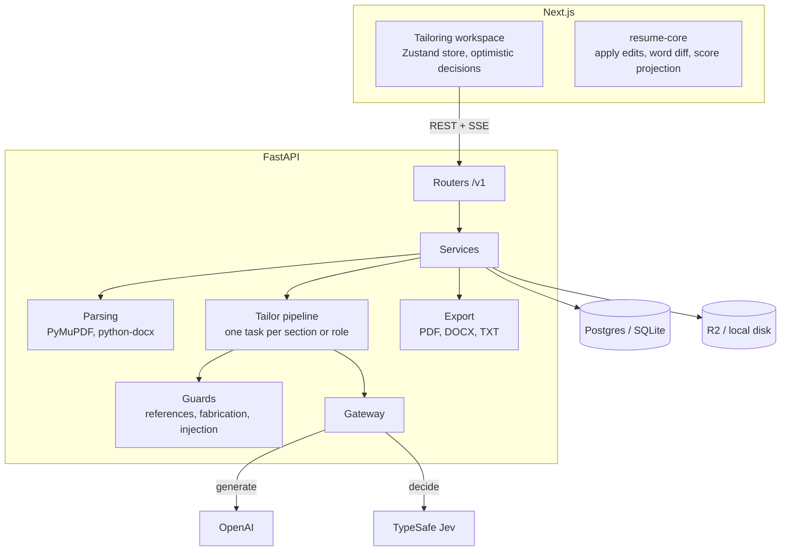

# Architecture

## Overview



The API is the single source of truth for the contract. It exports `openapi.json` without starting a server, and `openapi-typescript` turns that into `packages/api-client`, including real TypeScript enums for every closed set of values (statuses, operations, error codes, event names). Changing a Pydantic model and running `pnpm dev` regenerates the client before the web app type-checks against it, and CI fails if the generated files are out of date.

## A tailoring run

1. `POST /v1/tailor-sessions` validates ownership, saves the session and returns `202 {id}` at once. The job description is stored but not analysed.
2. A background task reads the job description, then runs the pipeline. Model output is parsed as it streams, so each suggestion is checked, saved and published the moment the model finishes writing it. The first `tailoring` event carries the plan (pieces of work per section) and each piece reports back when it finishes, which is how the UI ticks sections off.
3. `GET /v1/tailor-sessions/{id}/stream` relays those events over SSE. Each event id is a sequence number, so a reconnecting browser resumes with `Last-Event-ID`. After the run, a refresh replays from the database.

Every event payload has a Pydantic model (`app/schemas/stream.py`) that is exported in the OpenAPI document, so the browser handles each event with a real type, and a test checks that everything a run publishes validates against its model.

## The pipeline

```
read the job ──► Jev input gate (is it a job description? injected instructions?) ──► OpenAI structured analysis
resume tree (stable node ids) ──► score before (Jev rates every requirement; keyword fallback)
for each section or role, in parallel (up to 6 at once):
    OpenAI proposes operations as strict JSON, streamed  ──►  schema validation (+1 repair attempt)
    reference check   (the target exists, is the right kind, is in this section)
    fabrication guard (new numbers become [X]; new technologies are flagged)
    Jev grounding     (supported? overstated? contradicts? does the rewrite beat the original?)
        contradicts, not an improvement, different work  ->  dropped
        overstated, unsupported, low confidence          ->  "only accept if true", needs a one-tap confirm
score projected (every safe operation applied, re-scored)
```

## The workspace

`/tailor/new` and `/tailor/{id}` render the same component (`features/workspace`). Sending the job description starts the session and swaps the address in place, so there is no second screen to load. The conversation is derived from the run's state (`steps.ts`, pure and unit-tested), so a refresh or a reconnect rebuilds the same thread. The suggestion under review sits in a fixed dock above the composer rather than floating over the resume, so accepting, rejecting and stepping never cover or move the document.

## Decisions

**Generate with OpenAI, decide with Jev.** A tailoring tool is only useful if it can be trusted not to invent experience, and a model that writes a bullet and also judges whether it is true tends to agree with itself. OpenAI writes. TypeSafe Jev makes the typed decisions around the writing, each with a calibrated confidence: high acts automatically, medium shows a "check this" tag, low is never trusted. Every decision has a deterministic fallback, so Jev being down lowers quality ("basic mode") but never blocks the user. Thresholds are tuned per pinned Jev version, so upgrading the pin means re-running the evals first.

**The model emits operations, never a rewritten document.** Resumes are parsed into a tree with stable node ids, and the model returns typed operations (`replace_text`, `reorder`, `insert_bullet`, `add_skill`, ...) that reference those ids. Untouched text cannot drift, each operation maps to one decision, output tokens drop several-fold, and prompt injection has nowhere to go because output is schema-constrained and id-referenced. One pure function, `apply_ops`, produces the final document. It exists in Python and TypeScript and both run against the same vectors in `packages/fixtures/apply-ops`, so the preview in the browser and the saved version cannot disagree.

**An in-process, replayable event log instead of Redis and a worker.** Generation runs as a background task in the API process, events go to an in-memory log per session, and suggestions are saved as they arrive. That needs no extra infrastructure and survives a refresh. A restart mid-run fails that session (the user retries, nothing is lost), and several API instances would not share streams. `TailorBroker` has the same contract as a Redis Streams implementation, so swapping it in is contained.

**Closed sets are enums, on both sides.** The backend defines each one once as a string enum. They reach the generated client as TypeScript enums, and a test fails the build if the frontend writes one of their values as a bare string.

**No comments, no nested functions.** Code explains itself through names and small module-level functions. Tests enforce both rules in Python and TypeScript.

## Limits

AI calls are capped: each task has an output budget under a global ceiling, job descriptions over the limit are rejected, and resume text is clipped before it is sent. Prompts are versioned files in `apps/backend/app/ai/prompts/` and the version is stored on each session.

## Security and privacy

- Passwords are hashed with argon2id. A short-lived access token and a rotating refresh token live in `httpOnly` cookies, and presenting a used refresh token revokes the whole family. A dead session clears its cookies so the client lands on sign-in and stays there.
- State-changing browser requests are origin-checked on top of `SameSite`.
- Compensation is encrypted at rest, decrypted only for its owner and excluded from every prompt. The fit check compares it in code.
- Uploads are validated by magic bytes, not extension, with size and page caps and a clear message for password-protected PDFs. With R2, files are private and served by 5-minute presigned URLs.
- Job descriptions are treated as untrusted data: invisible characters are stripped and lines that look like instructions to an AI are removed.
- "Delete my data" removes the user, every row by cascade, and the user's stored files.

## Known limits

- No rate limiting yet. Add a token bucket before opening sign-ups publicly.
- Scores are estimates. They are explainable and stable, but they are not a real applicant-tracking vendor's algorithm.
- Compensation fit only works when the job states a range in the same currency as yours.
- Exports use ReportLab rather than an HTML renderer, which keeps the container free of system libraries at the cost of simpler typography.
- English only.
